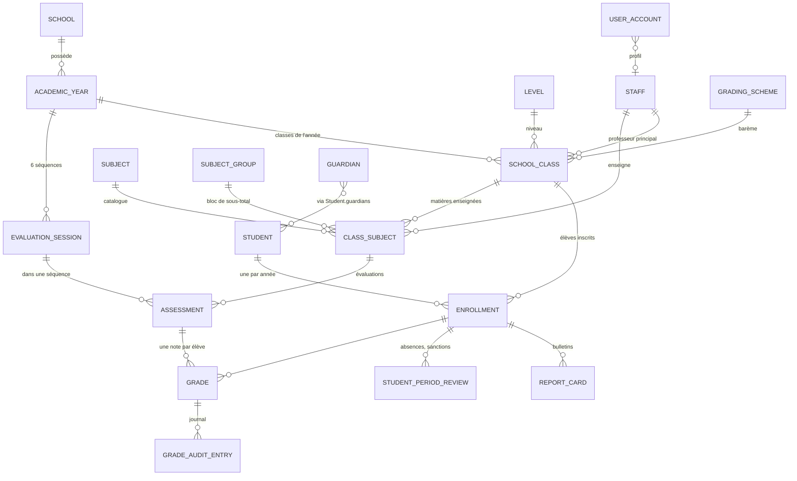
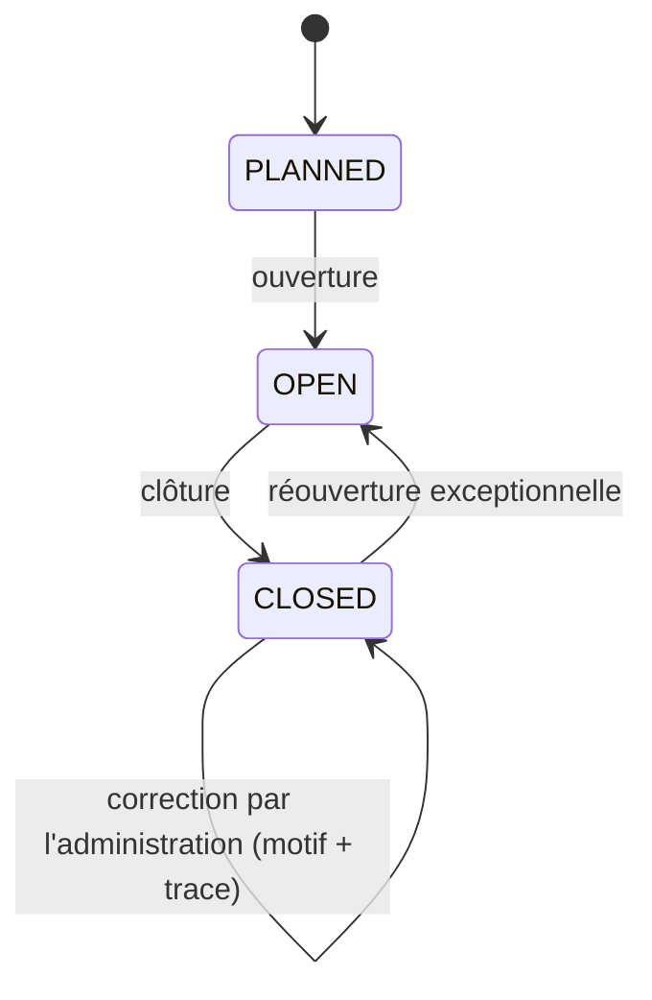

# 02 — Domaine métier

## 1. Glossaire bilingue

| Français | English | Dans le modèle |
|---|---|---|
| Établissement | School | `School` |
| Année scolaire | Academic year | `AcademicYear` |
| Trimestre | Term | `Term` (dans `AcademicYear.terms`) |
| Séquence (DEV1..DEV6) | Evaluation session / sequence | `EvaluationSession` |
| Niveau (6ème, Tle, Form 3) | Level / Form | `Level` |
| Classe | Class | `SchoolClass` |
| Série / filière | Track / series | `SchoolClass.trackCode` |
| Discipline / matière | Subject | `Subject` |
| Groupe de matières | Subject group | `SubjectGroup` |
| Matière d'une classe (coef., enseignant) | Class subject (teaching assignment) | `ClassSubject` |
| Enseignant / personnel | Teacher / staff | `Staff` |
| Professeur principal | Class master / mistress | `SchoolClass.mainTeacherId` |
| Élève | Student / pupil | `Student` |
| Parent / tuteur | Parent / guardian | `Guardian` |
| Inscription | Enrollment | `Enrollment` |
| Matricule | Matricule number | `Student.matricule` |
| Redoublant | Repeater | `Enrollment.repeater` |
| Effectif | Class size / roll | `ClassSnapshot.effectif` |
| Évaluation (devoir, interro) | Assessment (test, quiz) | `Assessment` |
| Note | Grade / mark | `Grade` |
| Coefficient | Coefficient / weight | `ClassSubject.coefficient` |
| Moyenne | Average | calculé |
| Rang | Rank | calculé |
| Appréciation | Appreciation | `ScoreBand` |
| Bulletin | Report card | `ReportCard` |
| Conseil de classe | Class council | `StudentPeriodReview.councilDecision` |
| Tableau d'honneur | Honour roll | `DistinctionLevel` |
| Avertissement / Blâme | Warning / Blame | `SanctionLevel` |
| Clôture de séquence | Closing of a session | `SessionStatus.CLOSED` |
| Barème | Grading scheme | `GradingScheme` |

## 2. Acteurs

| Acteur | Rôle d'accès (`Role`) | Ce qu'il fait |
|---|---|---|
| Élève | `STUDENT` | Plus tard : se connecte avec son matricule, suit ses notes en temps réel |
| Parent / tuteur | `PARENT` | Suit les notes de ses enfants en temps réel ; télécharge le bulletin annuel publié |
| Enseignant | `TEACHER` | Saisit et modifie les notes de **ses** matières et classes tant que la séquence est ouverte |
| Administration (secrétariat, censeur, surveillants) | `ADMINISTRATION` | Tout ce que fait l'enseignant ; corrige après clôture ; gère matières, coefficients, enseignants, élèves, inscriptions ; génère et imprime les bulletins |
| Directeur / chef d'établissement | `DIRECTOR` | Accès complet ; gère les comptes d'administration |
| Développeur | `SUPER_ADMIN` | Accès plateforme et support |

Détail des droits : `05-roles-permissions.md`.

## 3. Relations entre les entités

Lecture clé : **`ClassSubject` est le pivot.** C'est lui qui répond à « qui enseigne quoi, à quelle classe, avec quel coefficient, dans quel groupe » et qui autorise la saisie des notes.

## 4. Règles métier

### 4.1 Enseignants, matières, classes, salles
- **BR-01** Un enseignant peut avoir plusieurs `ClassSubject` : plusieurs matières, dans plusieurs classes, dans plusieurs sections.
- **BR-02** Un `ClassSubject` a au plus un enseignant titulaire à la fois (`teacherId`, vide tant que non affecté).
- **BR-03** Une matière n'existe qu'une fois par classe et par année (unicité classe + matière).
- **BR-04** Le groupe de sous-total et le coefficient d'une matière se décident **par classe**, jamais globalement.
- **BR-05** Un enseignant ne peut créer ou modifier des notes que pour les `ClassSubject` dont il est `teacherId`.
- **BR-06** Une classe a au plus un professeur principal, qui peut enseigner ou non dans cette classe.
- **BR-07** Une personne peut cumuler les fonctions (enseignant + chef d'établissement, enseignant + censeur). Une seule fiche `Staff`.
- **BR-08** Un enseignant remplacé en cours d'année : on change `ClassSubject.teacherId`. Les bulletins déjà générés gardent le nom figé ; les anciennes saisies gardent leur auteur dans `GradeAuditEntry`. (Q-22)
- **BR-09** *(module emplois du temps)* Un enseignant, une salle et une classe ne peuvent pas être dans deux créneaux simultanés.

### 4.2 Évaluations et notes
- **BR-10** Une note est comprise entre 0 et le barème de l'évaluation (20 par défaut), avec 2 décimales au plus.
- **BR-11** Une seule note par élève et par évaluation.
- **BR-12** Un élève ne peut recevoir une note que s'il a une inscription `ENROLLED` dans la classe de l'évaluation.
- **BR-13** Statuts d'une note : saisie, en attente, absent, absent justifié, dispensé. La valeur n'existe que pour « saisie ». La façon de compter un absent ou une note manquante vient du `GradingScheme`.
- **BR-14** Les notes publiées sont visibles immédiatement par l'élève et ses parents (temps réel). Une évaluation en brouillon (`published = false`) reste invisible.
- **BR-15** Toute création, modification ou suppression de note écrit une ligne dans `GradeAuditEntry` (qui, quand, ancienne et nouvelle valeur).

### 4.3 Séquences et clôture
- **BR-20** Une année compte 6 séquences ; les séquences 1-2, 3-4 et 5-6 forment les trimestres 1, 2, 3.
- **BR-21** Une séquence `OPEN` accepte les saisies des enseignants (CRUD complet sur leurs notes).
- **BR-22** Une séquence `CLOSED` refuse toute saisie d'enseignant. Seule l'administration peut corriger, avec un **motif obligatoire**, et la correction est tracée avec `afterSessionClosed = true`.
- **BR-23** Clôturer et rouvrir une séquence sont des actions de l'administration (rouvrir : à réserver au directeur, à confirmer, Q-04).
- **BR-24** Les bulletins d'une période ne se génèrent définitivement que lorsque ses séquences sont clôturées (génération de brouillon possible avant).

### 4.4 Bulletins
- **BR-30** Un bulletin généré est une **photographie figée** (`ReportCard`) : noms de matières, d'enseignants, coefficients et résultats y sont recopiés.
- **BR-31** Si une note change après génération, on génère une nouvelle révision ; l'ancienne passe en `SUPERSEDED`. On n'écrase jamais un bulletin publié.
- **BR-32** Un élève ou un parent ne télécharge que le bulletin **annuel** au statut `PUBLISHED`, uniquement pour l'élève concerné (et pour un parent : seulement ses enfants avec `canDownloadReportCards`).
- **BR-33** La langue du bulletin est celle de la classe (`SchoolClass.reportLanguage`). L'en-tête officiel reste bilingue.
- **BR-34** Un élève sans moyenne calculable n'est pas classé : il compte dans l'effectif, pas dans `rankedCount` ni dans les statistiques de la classe.
- **BR-35** Chaque bulletin reçoit un `verificationCode` aléatoire et unique, imprimé en code-barres / QR, pour contrôler son authenticité.
- **BR-36** Absences, retards, sanctions, distinctions et décision du conseil sont **saisis** (`StudentPeriodReview`), pas calculés.

### 4.5 Élèves et inscriptions
- **BR-40** Le matricule est unique dans l'école.
- **BR-41** Un élève a au plus une inscription par année scolaire.
- **BR-42** On désactive (`active = false`) un élève ou un enseignant plutôt que de le supprimer : notes et bulletins le référencent.
- **BR-43** Les données des élèves (mineurs) ne figurent jamais dans les logs, jeux de test ou dépôts Git.

### 4.6 Bilinguisme
- **BR-50** Les noms de matières, de groupes, de trimestres sont stockés en `LocalizedText(fr, en)`.
- **BR-51** Une classe francophone imprime en français, une classe anglophone en anglais ; le comportement d'une classe « bilingue » est à décider (Q-01).
- **BR-52** L'interface (libellés, messages d'erreur) est bilingue ; la langue de l'utilisateur est indépendante de celle du bulletin.

## 5. Parcours principal : de la saisie au bulletin

1. **Préparation (administration)** : créer l'année et ses 3 trimestres et 6 séquences ; créer les classes ; affecter à chaque classe ses matières (`ClassSubject`) avec coefficient, groupe et enseignant ; inscrire les élèves.
2. **Ouverture** de la séquence n.
3. **Saisie (enseignants)** : pour chaque `ClassSubject` dont ils sont titulaires, créer l'évaluation puis saisir une note par élève. Les notes sont visibles en temps réel pour l'élève et ses parents.
4. **Clôture** de la séquence par l'administration. Les corrections ultérieures passent par l'administration, avec motif et trace.
5. **Saisie des éléments hors notes** : absences, retards, sanctions, distinctions (`StudentPeriodReview`).
6. **Génération** des bulletins : calcul (voir `04-regles-de-calcul.md`), création des `ReportCard` en `DRAFT`.
7. **Validation** par l'administration, puis **impression** (PDF) ou **publication** du bulletin annuel pour les parents.
8. En fin d'année : conseil de classe, décision de passage, publication, clôture de l'année.

## 6. Modules suivants (hors modèle actuel)

| Module | Ce qui sera ajouté |
|---|---|
| Emplois du temps | `TimetableSlot` (jour, heure, classe, matière, enseignant, salle), contrôle de conflits, vues enseignant / élève / salle |
| Cartes d'élèves | Gabarit de carte, génération PDF, code QR vers `Student` |
| Inscriptions | Dossier d'inscription, pièces, réinscription, génération du matricule |
| Frais de scolarité (si retenu) | Barème, versements, reçus, lien avec l'inscription (Mobile Money) |
| Portail élève / parent | Consultation des notes et téléchargement des bulletins |
