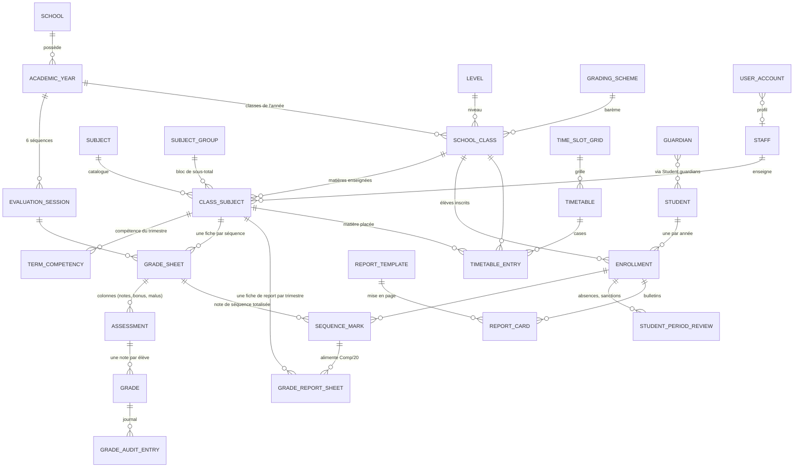
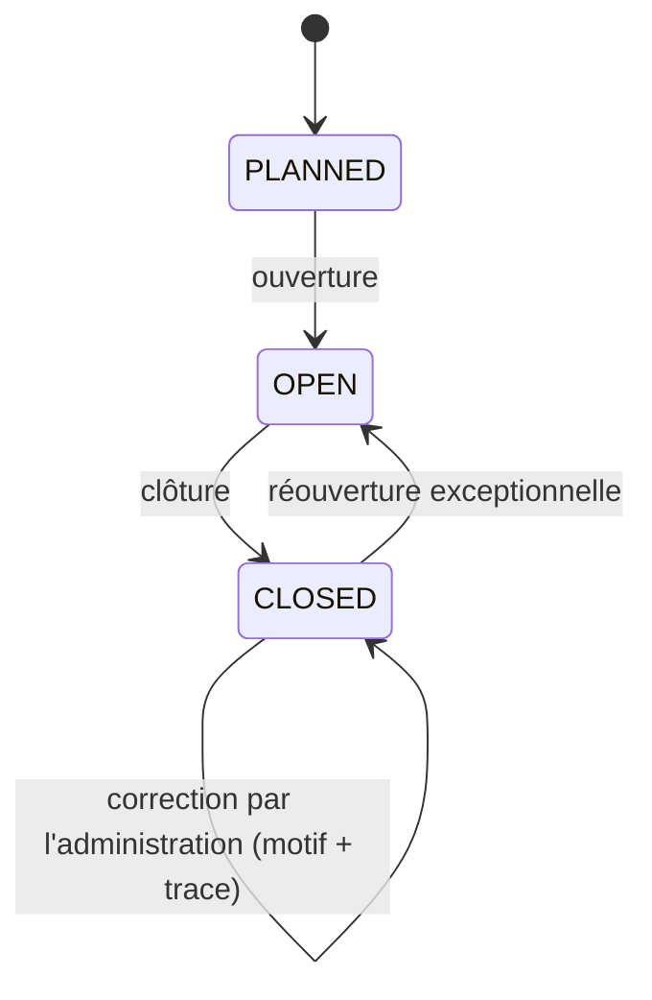

# 02 — Domaine métier

> Mis à jour avec les 7 bulletins, l'emploi du temps et les réponses de Ben (Q-01, 02, 03, 08, 10, 11, 14, 17, 19, 20).
> Chaque terme du glossaire renvoie au **module** qui le possède (futur microservice, voir `08-architecture-modulaire.md`).

## 1. Principe directeur

Le logiciel permet de **tout configurer depuis l'interface graphique, dans les deux langues** : créer des matières, des notes, modifier n'importe quelle donnée, y compris les barèmes, les gabarits de bulletin et les mentions. Aucune règle de l'école n'est figée dans le code ; elle est une donnée. Import des élèves : plus tard (sinon création un par un).

## 2. Glossaire bilingue

| Français | English | Module | Dans le modèle |
|---|---|---|---|
| Établissement | School | academic | `School` |
| Année scolaire | Academic year | academic | `AcademicYear` |
| Trimestre | Term | academic | `Term` (dans `AcademicYear.terms`) |
| Séquence (DEV1..DEV6) | Evaluation session / sequence | grading | `EvaluationSession` |
| Niveau (6ème, Tle, Form 3) | Level / Form | academic | `Level` |
| Classe | Class | academic | `SchoolClass` |
| Série / filière (C, ALL, ARTS, SC) | Track / series | academic | `SchoolClass.trackCode` |
| Discipline / matière | Subject | academic | `Subject` |
| Groupe de matières | Subject group | academic | `SubjectGroup` |
| Matière d'une classe (coef., enseignant, heures) | Class subject | academic | `ClassSubject` |
| Compétence visée | Competency | academic | `TermCompetency` |
| Salle | Room | academic | `Room` |
| Enseignant / personnel | Teacher / staff | staff | `Staff` |
| Professeur principal | Class master / mistress | academic | `SchoolClass.mainTeacherId` |
| Élève | Student / pupil | student | `Student` |
| Parent / tuteur | Parent / guardian | student | `Guardian` |
| Inscription | Enrollment | student | `Enrollment` |
| Effectif (N° ON ROLL) | Class size / roll | student → reporting | nombre d'inscrits (`ClassSnapshot.effectif`) |
| Fiche de notes (d'un enseignant) | Grade sheet | grading | `GradeSheet` |
| Fiche de report de notes | Grade report sheet | grading | `GradeReportSheet` |
| Colonne de la fiche : note, bonus, malus | Assessment column | grading | `Assessment` |
| Note brute | Grade / mark | grading | `Grade` |
| Note de séquence (DEVn) | Sequence mark | grading | `SequenceMark` |
| Barème | Grading scheme | grading | `GradingScheme` |
| Surveillant Général | Senior supervisor | user | `Role.SURVEILLANT_GENERAL` |
| Gabarit de bulletin | Report card template | reporting | `ReportTemplate` |
| Bulletin | Report card | reporting | `ReportCard` |
| Conseil de classe | Class council | reporting | `StudentPeriodReview.councilDecision` |
| Tableau d'honneur | Honour roll | reporting | `DistinctionLevel` |
| Avertissement / Blâme | Warning / Blame | reporting | `SanctionLevel` |
| Emploi du temps | Timetable | timetable | `Timetable` + `TimetableEntry` |
| Grille horaire | Time slot grid | timetable | `TimeSlotGrid` |
| Compte de connexion | User account | user | `UserAccount` |

## 3. Acteurs

| Acteur | `Role` | Ce qu'il fait |
|---|---|---|
| Élève | `STUDENT` | Plus tard : se connecte avec son matricule, suit ses notes en temps réel |
| Parent / tuteur | `PARENT` | **Navigateur uniquement** (réponse Q-20) : se connecte à son compte et voit automatiquement les notes et les bulletins de **tous ses enfants, et uniquement les siens** ; télécharge le bulletin annuel publié |
| Enseignant | `TEACHER` | Remplit les **fiches de notes** de ses matières et classes tant que la séquence est ouverte ; génère / soumet sa **fiche de report** ; consulte son emploi du temps |
| Surveillant Général | `SURVEILLANT_GENERAL` | Lit et **vise** les fiches de report (visa SG) ; Q-38 ouverte sur le périmètre exact |
| Administration | `ADMINISTRATION` | Tout ce que fait l'enseignant ; corrige après clôture ; régénère / corrige les fiches de report avec motif ; gère matières, coefficients, enseignants, élèves, inscriptions, emplois du temps ; génère et imprime les bulletins |
| Directeur / Principal | `DIRECTOR` | Accès complet ; visa final Principal des fiches de report (Q-38 : rôle PRINCIPAL distinct ?) ; gère les comptes d'administration |
| Développeur | `SUPER_ADMIN` | Accès plateforme et support |

Détail : `05-roles-permissions.md`.

## 4. Relations entre les entités

Lecture clé : **`ClassSubject` est le pivot** (qui enseigne quoi, à quelle classe, avec quel coefficient, dans quel groupe, combien d'heures). Il autorise la saisie des notes **et** alimente l'emploi du temps. Entre modules, les liens ci-dessus sont des **identifiants**, jamais des jointures.

## 5. Règles métier

### 5.1 Enseignants, matières, classes, salles
- **BR-01** Un enseignant peut avoir plusieurs `ClassSubject` : plusieurs matières, dans plusieurs classes, dans plusieurs sections.
- **BR-02** Un `ClassSubject` a au plus un enseignant titulaire à la fois (vide tant que non affecté : cas observé).
- **BR-03** Une matière n'existe qu'une fois par classe et par année (unicité classe + matière).
- **BR-04** Le groupe de sous-total et le coefficient d'une matière se décident **par classe**.
- **BR-05** Un enseignant ne peut modifier une fiche de notes que pour les `ClassSubject` dont il est `teacherId`.
- **BR-06** Une classe a au plus un professeur principal ; une même personne peut être professeur principal de plusieurs classes (observé : 2NDE C et 2NDE ALL).
- **BR-07** Une personne peut cumuler les fonctions (enseignant + chef d'établissement). Une seule fiche `Staff`.
- **BR-08** Enseignant remplacé : on change `ClassSubject.teacherId`. Les bulletins déjà générés gardent le nom figé. (Q-22)
- **BR-09** Un enseignant, une salle et une classe ne peuvent pas être dans deux créneaux simultanés de l'emploi du temps (module timetable, voir `09-emploi-du-temps.md`).
- **BR-10** Une matière `kind = ACTIVITY` (club, bibliothèque, musique, ménage général) n'est jamais notée ni imprimée sur un bulletin.

### 5.2 Fiches de notes et notes (réponse Q-02)
- **BR-11** Il existe une **fiche de notes par séquence et par `ClassSubject`** (`GradeSheet`). L'enseignant y saisit pour chaque élève les notes, les bonus, les malus, etc. (`Assessment` = colonnes, `Grade` = valeurs).
- **BR-12** Le logiciel **totalise automatiquement** chaque élève en une **note de séquence** (`SequenceMark`) ; c'est cette note qui s'imprime dans DEVn. La formule exacte de totalisation est paramétrable (`TotalizationRule`, Q-25).
- **BR-13** Une note est comprise entre 0 et le barème de la colonne (20 par défaut), 2 décimales au plus ; une note de séquence aussi (plafond 20 après bonus).
- **BR-14** Une seule note par élève et par colonne ; un seul `SequenceMark` par élève et par fiche.
- **BR-15** Un élève ne reçoit une note que s'il a une inscription `ENROLLED` dans la classe de la fiche.
- **BR-16** Statuts : saisie, en attente (« - »), absent, absent justifié, dispensé. La valeur n'existe que pour « saisie ». **Une note non saisie n'est jamais un zéro.** (Q-31)
- **BR-17** Les notes de séquence publiées sont visibles en temps réel par l'élève et ses parents.
- **BR-18** Toute création, modification, suppression de note, de bonus, de malus ou de note de séquence écrit une ligne dans `GradeAuditEntry` (qui, quand, avant, après, rôle, motif, après clôture ?).
- **BR-19** La fiche peut être exportée sur **plusieurs pages** (document personnel de l'enseignant) ; ce n'est pas un bulletin.

### 5.2 bis Fiche de report de notes (design papier trimestriel)
- **BR-70** Une **fiche de report** (`GradeReportSheet`) existe par `ClassSubject` et par trimestre (2 séquences côte à côte). Elle est un **instantané** des `SequenceMark` ; elle ne remplace pas la `GradeSheet` (bonus/malus restent dans le fichier de travail).
- **BR-71** Colonnes par séquence : Comp/20, Coef, Note×Coef, Rang (dans la matière), App. Lignes : N° (`Enrollment.rollNumber`), noms figés, sexe. En-tête : classe, enseignant, matière, coefficient, **N° = numéro du trimestre** (Q-35), effectif, garçons, filles, dates de composition (`EvaluationSession.examDate`).
- **BR-72** Rang : moyenne exacte, ex aequo en compétition (1, 2, 2, 4), parmi les élèves SCORED ; PENDING → pas de rang.
- **BR-73** `weightedMark = mark × coefficient` ; PENDING → cellules numériques vides, jamais 0.
- **BR-74** App calculée automatiquement via l'échelle du barème (LETTER / COMPETENCY, Q-10 / Q-36) ; version **vierge** imprimable (noms seuls) pour saisie manuscrite.
- **BR-75** PDF A4 paysage ; jusqu'à `reportSheetMaxRowsPerPage` (45) lignes / page, puis pages suivantes avec en-tête répété (Q-35). Pied : visas Enseignant, Surveillant Général, Principal ; mention ratures + délai 72 h.
- **BR-76** Cycle : DRAFT → SUBMITTED (enseignant, manuel **ou automatique BR-79**) → VISA_SG → VISA_PRINCIPAL ; REJECTED avec motif → retour possible en régénération DRAFT.
- **BR-77** Délai `reportSheetDeadlineHours` (72) après `examDate` : **avertissement** seulement tant que `reportSheetDeadlineBlocking = false` (Q-37).
- **BR-78** Élève et parent : **aucun accès** à la fiche de report. Correction sur fiche déjà soumise/visée : motif + approbation Principal (`GradeAuditEntry.approvedBy`).
- **BR-79** À la **clôture** d’une séquence (`EvaluationSession` → `CLOSED`) par un utilisateur habilité (BR-23), le **visa enseignant** est posé automatiquement sur toutes les fiches de report (`GradeReportSheet`) du **même trimestre** encore en `DRAFT` ou `REJECTED` : passage en `SUBMITTED`, `submittedAt` / `submittedBy` = auteur de la clôture, motif d’audit `AUTO_ON_SESSION_CLOSE`. Les fiches déjà soumises ou visées (SG / Principal) ne sont pas modifiées.

### 5.3 Séquences et clôture
- **BR-20** Une année compte 6 séquences ; 1-2, 3-4, 5-6 forment les trimestres 1, 2, 3. Chaque séquence = une `EvaluationSession`.
- **BR-21** Séquence `OPEN` : l'enseignant a le CRUD complet sur les notes de ses fiches.
- **BR-22** Séquence `CLOSED` : plus aucune saisie directe d'enseignant. Une **demande de correction** (BR-80) est possible ; la modification persistante n’est appliquée qu’après **approbation du directeur**. Trace `afterSessionClosed = true` + `approvedBy`.
- **BR-23** Clôturer : administration ou directeur ; rouvrir : directeur seul (Q-04).
- **BR-80** Après clôture : l’enseignant titulaire peut **proposer** une correction Comp./20 (nouvelle note, motif ≥ 15 caractères, 0–3 pièces JPEG/PNG/WebP/PDF ≤ 5 Mo, empreinte SHA-256). Une seule demande `PENDING` par élève / colonne. **Seul le directeur** (ou `SUPER_ADMIN`) peut **approuver** (écrit la note + audit) ou **rejeter** (motif de revue). Collection `grading_correction_requests` (+ preuves).
- **BR-81** À la clôture d’une séquence, chaque enseignant titulaire (compte lié) reçoit une **notification in-app** bilingue avec **accusé de réception obligatoire**. Canal professionnel uniquement (pas de chat). Événement outbox `grading.session.closed` → module `notification`.
- **BR-82** Un enseignant peut **signaler** une erreur ou une information à l’administration / direction (`StaffSignal` : objet + message, catégories fixes). Statuts `OPEN` → `ACKNOWLEDGED` → `CLOSED`. **Pas de fil de discussion** ni d’échange entre enseignants.
- **BR-24** Le bulletin d'une période ne se génère définitivement que lorsque ses séquences sont clôturées (brouillon possible avant).
- **BR-25** Au plus **2** séquences `OPEN` en même temps pour une année ; elles appartiennent forcément au **même trimestre** (donc un seul trimestre « actif » à la fois). L’ouverture / clôture est un paramètre d’administration (pas un choix libre enseignant).

### 5.4 Bulletins (une seule page A4)
- **BR-30** Un bulletin généré est une **photographie figée** (`ReportCard`).
- **BR-31** Si une note change après génération : nouvelle révision, l'ancienne passe en `SUPERSEDED`. On n'écrase jamais un bulletin publié.
- **BR-32** Un élève ou un parent ne télécharge que le bulletin **annuel** `PUBLISHED`, uniquement pour l'élève concerné ; un parent voit **tous ses enfants**, jamais ceux d'un autre (réponse Q-20).
- **BR-33** Le bulletin se génère **dans les deux langues** ; la langue de la section est prioritaire (`SchoolClass.defaultLanguage`) ; pour une classe bilingue les deux sont opérationnelles (réponse Q-01). L'en-tête officiel reste bilingue. Tous les libellés existent en FR et en EN.
- **BR-34** Un élève sans moyenne n'est pas classé : il compte dans l'effectif, pas dans `rankedCount` ni dans les statistiques de la classe.
- **BR-35** Chaque bulletin reçoit un `verificationCode` aléatoire unique à 13 chiffres imprimé en code-barres / QR.
- **BR-36** Absences, retards, sanctions, distinctions et décision du conseil sont **saisis** (`StudentPeriodReview`), pas calculés (sauf tableau d'honneur proposé par la règle des 12/20, BR-37).
- **BR-37** Tableau d'honneur : moyenne >= 12 (paramétrable) ; hypothèse : bloqué par un avertissement ou un blâme (Q-29).
- **BR-38** **Un bulletin tient sur UNE SEULE page A4 portrait.** Le générateur ajuste la taille de police et la hauteur des lignes (bornes dans `ReportTemplate`) ; si le contenu ne tient pas au minimum, la génération échoue avec un message clair, elle ne produit jamais une seconde page.
- **BR-39** Le gabarit (colonnes, compétence, rang par matière, échelle d'appréciation, seuil du profil de classe) est une donnée (`ReportTemplate`), choisie selon la période, le niveau et la section.

### 5.5 Élèves et inscriptions
- **BR-40** Le matricule est unique dans l'école (texte libre : numérique ou alphanumérique, Q-05).
- **BR-41** Un élève a au plus une inscription par année scolaire.
- **BR-42** On désactive plutôt que de supprimer (élève, enseignant, matière, classe).
- **BR-43** Les données des élèves (mineurs) ne figurent jamais dans les logs, jeux de test ou dépôts Git.

### 5.6 Bilinguisme
- **BR-50** Noms de matières, groupes, trimestres, mentions, légendes : `LocalizedText(fr, en)`.
- **BR-51** Matières : certaines sont enseignées entièrement en français, d'autres entièrement en anglais (`Subject.teachingLanguage`, `ClassSubject.teachingLanguage`).
- **BR-52** L'interface (libellés, messages d'erreur) est bilingue ; la langue de l'utilisateur est indépendante de celle du document.
- **BR-53** Tout est modifiable depuis l'interface graphique dans les deux langues.

### 5.7 Emploi du temps (une seule page A4)
- **BR-60** L'emploi du temps est **généré une seule fois par an** (`Timetable`, une version publiée par année) ; semaine type répétée toute l'année.
- **BR-61** Une case = classe + jour + période de départ (+ nombre de périodes) + matière + enseignant (+ salle). Cases spéciales : activité sans note, case mixte, TD, cours hors grille (samedi).
- **BR-62** **Impression : une seule page A4 paysage par classe** (et par enseignant ou par salle sur demande), jamais de seconde page.
- **BR-63** Le nombre de périodes d'une matière doit correspondre à `ClassSubject.weeklyHours` (avertissement, pas blocage).

## 6. Parcours principal : de la saisie au bulletin

1. **Préparation (administration)** : année, classes, matières de classe (coefficient, groupe, enseignant, heures), inscription des élèves, grille horaire et emploi du temps.
2. **Ouverture** de la séquence n ; création automatique des fiches de notes.
3. **Saisie (enseignants)** : chaque enseignant remplit sa fiche ; le logiciel totalise la note de séquence ; les notes sont visibles en temps réel pour l'élève et ses parents.
3 bis. **Fiche de report** (par trimestre) : génération depuis les `SequenceMark`, soumission enseignant (ou **visa enseignant auto à la clôture de séquence**, BR-79), visas SG puis Principal (ou impression vierge pour workflow manuscrit).
4. **Clôture** de la séquence (administration) ; corrections ensuite avec motif et trace.
5. **Éléments hors notes** : absences, retards, sanctions, distinctions, compétences du trimestre.
6. **Génération** des bulletins : calcul (`04-regles-de-calcul.md`), `ReportCard` en `DRAFT`, PDF une page.
7. **Validation**, impression, publication du bulletin annuel pour les parents.
8. Fin d'année : conseil de classe, décision de passage, clôture.

## 7. Modules (futurs microservices)

Voir `08-architecture-modulaire.md`. Modules déjà modélisés : `user`, `academic`, `student`, `staff`, `grading`, `reporting`, `timetable` (+ `shared`). Modules suivants : cartes d'élèves, inscriptions/matricule, frais de scolarité, notifications, stockage de fichiers, import des élèves.
