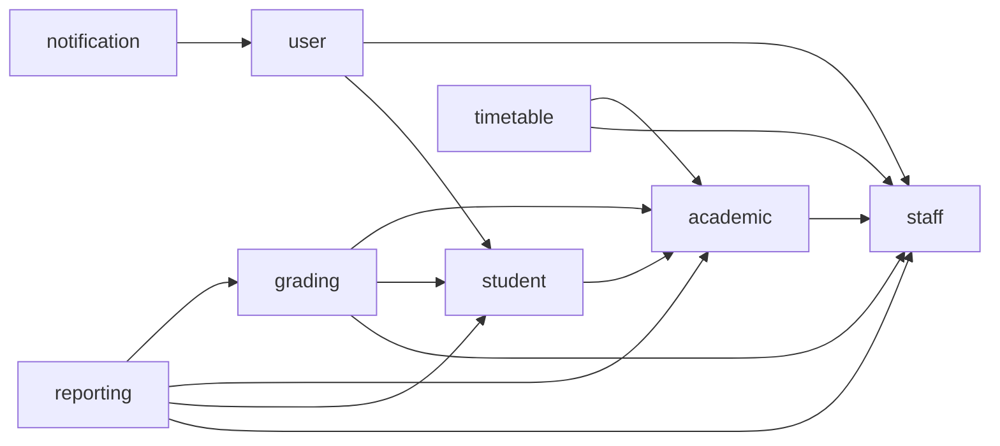

# 08 — Architecture modulaire : monolithe aujourd'hui, microservices demain

> Exigence de Ben : le backend est un monolithe maintenant, mais passera plus tard en **microservices avec une gestion décentralisée**, avec un module dédié à l'emploi du temps, aux notes, aux étudiants (CRUD sur leurs informations), etc. **Tout doit être pensé dès maintenant** pour que l'extraction se fasse sans réécriture.
> Principe : un **monolithe modulaire**. Chaque module est un futur microservice ; il possède ses données, expose une interface, et ne touche jamais aux données des autres.

## 1. Les modules

| Module | Propriétaire de | Collections (préfixe = module) | Dépend de (par identifiants et interfaces) |
|---|---|---|---|
| `shared` | noyau commun (pas un service) | `shared_outbox_events` | rien |
| `user` | comptes, rôles, authentification, sessions | `user_accounts`, `user_sessions` | rien (référence `staff`, `student`, `guardian` par id) |
| `academic` | établissement, années, niveaux, classes, salles, matières, groupes, matières de classe, compétences | `academic_schools`, `academic_years`, `academic_levels`, `academic_classes`, `academic_rooms`, `academic_subjects`, `academic_subject_groups`, `academic_class_subjects`, `academic_term_competencies` | `staff` (ids) |
| `student` | élèves, tuteurs, inscriptions (CRUD sur leurs informations) | `student_students`, `student_guardians`, `student_enrollments` | `academic` (ids de classe, année) |
| `staff` | enseignants et administration | `staff_members` | rien |
| `grading` | séquences, fiches de notes, notes, notes de séquence, audit, barèmes | `grading_sessions`, `grading_sheets`, `grading_assessments`, `grading_grades`, `grading_sequence_marks`, `grading_audit_entries`, `grading_schemes` | `academic`, `student`, `staff` (ids) |
| `reporting` | gabarits, bulletins, absences/sanctions/décisions | `reporting_templates`, `reporting_report_cards`, `reporting_period_reviews` | `grading`, `academic`, `student`, `staff` |
| `timetable` | grille horaire, emplois du temps, cases | `timetable_grids`, `timetable_timetables`, `timetable_entries` | `academic`, `staff` (ids) |
| `notification` | boîte in-app, signalements officiels | `notification_inbox`, `notification_staff_signals` | `user` (ids de comptes) ; consomme outbox |

Futurs : `file-storage` (photos, logos, PDF), canaux externes SMS/WhatsApp/e-mail (sur `notification`), `fees`, `cards`, `enrollment`.


Les flèches vont du module qui **consomme** vers celui qui **fournit**. **Aucune flèche inverse, aucun cycle** : si un cycle apparaît, c'est que l'information doit descendre par un événement (§ 4) ou qu'un module est mal découpé.

## 2. Arborescence du projet

Ben a déjà les dossiers par couche (`configuration`, `controller`, `dto`, `exception`, `model`, `repository`, `service`). On garde cette organisation et on crée **le même sous-dossier de module dans chaque couche** :

```
com.kobe.smels
├── configuration/              socle technique (Mongo, Jackson, OpenAPI...) – commun
├── exception/                  exceptions et ProblemDetail – commun
├── shared/                     utilitaires communs (identité, tenant, événements) – commun
├── model/<module>/             documents du module   (shared, user, academic, student, staff, grading, reporting, timetable)
├── repository/<module>/        accès Mongo du module : JAMAIS utilisé hors du module
├── service/<module>/           logique du module
│   └── api/                    interfaces PUBLIQUES du module (ce que les autres modules ont le droit d'appeler)
├── controller/<module>/        API REST du module
└── dto/<module>/               objets d'échange du module, dont ceux des interfaces publiques
```
Pour extraire un module en microservice : on prend ses 5 dossiers (`model`, `repository`, `service`, `controller`, `dto`) + `shared`, on leur ajoute `configuration` et `exception`, et on remplace les appels `service/<autre>/api` par des clients HTTP.

## 3. Règles de frontière (à faire respecter, et à vérifier par un test d'architecture)

1. **Un module ne lit et n'écrit que ses propres collections.** Interdit : injecter le `repository` d'un autre module, ou importer son `model`.
2. **Un module parle à un autre via son interface publique** (`service/<autre>/api/*Api.kt`) en échangeant des **DTO** (`dto/<autre>/`), jamais des documents. Aujourd'hui l'implémentation est un appel direct dans le même processus ; demain c'est un client HTTP/gRPC ayant la **même interface**.
3. **Références par identifiant uniquement** (`classId`, `studentId`, `teacherId`...). Pas de jointure, pas de `$lookup` entre collections de modules différents.
4. **Copies de lecture** : quand un module a besoin d'un libellé d'un autre (nom de la matière, de l'enseignant sur l'emploi du temps ; nom de l'élève sur le bulletin), il en garde une **copie figée** dans son propre document (`subjectLabel`, `teacherLabel`, `StudentSnapshot`...), rafraîchie par événement ou à la publication. C'est déjà le cas dans `ReportCard` et `TimetableEntry`.
5. **Pas de transaction entre modules.** Une transaction Mongo ne couvre que les collections d'un module (et son `outbox`). Un traitement qui traverse plusieurs modules s'enchaîne par événements et se rattrape si une étape échoue (cohérence à terme).
6. **Pas de dépendance cyclique** entre modules (schéma ci-dessus).
7. **`schoolId` partout** (multi-établissement) ; il sert aussi de clé de partage (sharding) si un module grossit.
8. **Les identifiants sont des `String`** (ObjectId hexadécimal) uniques à l'échelle de la plateforme ; aucun identifiant séquentiel à base de compteur global.
9. **Sécurité par module** : chaque module contrôle lui-même les droits sur ses ressources à partir du jeton (qui reste le même partout : identité, rôles, `schoolId`, profil).
10. **Config et secrets par module** : un préfixe de configuration par module (`smels.grading.*`) ; une base Mongo par module en production (même cluster au début), nom `smels_<module>`.

Vérification automatique recommandée : un test **ArchUnit** (ou Spring Modulith) qui échoue si une classe de `service.<A>` importe `repository.<B>` ou `model.<B>` pour B ≠ A.

## 4. Événements entre modules

Chaque module écrit ses événements dans sa boîte d'envoi (`OutboxEvent`, même transaction que la modification), un publieur les diffuse (appel interne aujourd'hui ; courtier de messages demain : RabbitMQ, Kafka ou Redis Streams, au choix du moment), et les modules intéressés les consomment (de façon **idempotente** : un événement peut arriver deux fois).

| Événement | Émis par | Consommé par | Charge utile minimale |
|---|---|---|---|
| `academic.class-subject.changed` | academic | grading, timetable, reporting | `classSubjectId`, `classId`, `subjectId`, `teacherId`, `coefficient`, `groupId`, `weeklyHours` |
| `academic.class.changed` | academic | student, grading, reporting, timetable | `classId`, `name`, `levelCode`, `section`, `defaultLanguage` |
| `academic.subject.renamed` | academic | timetable, reporting | `subjectId`, noms FR/EN |
| `staff.member.changed` | staff | academic, timetable, reporting, user | `staffId`, nom affiché, civilité, `active` |
| `student.enrolled` / `student.enrollment.changed` | student | grading, reporting | `enrollmentId`, `studentId`, `classId`, `academicYearId`, statut |
| `student.guardian.linked` | student | user | `guardianId`, `studentId`, droits de consultation |
| `grading.session.opened` / `grading.session.closed` | grading | reporting, notification | `sessionId`, numéro, `termNumber` ; à la clôture : `shortLabel`, `academicYearId`, `teacherIds` (staff) |
| `grading.mark.changed` | grading | reporting (invalidation des brouillons) | `studentId`, `classSubjectId`, `sessionId` |
| `grading.report-sheet.submitted` | grading | notification | `reportSheetId`, `classSubjectId`, `termNumber`, `deadlineWarning` ; si BR-79 : `autoOnSessionClose`, `sessionId`, `sessionNumber` |
| `grading.report-sheet.visaed` | grading | notification | `reportSheetId`, `classSubjectId`, `termNumber`, `level` (SUPERVISOR\|PRINCIPAL) |
| `grading.report-sheet.rejected` | grading | notification | `reportSheetId`, `classSubjectId`, `termNumber`, `teacherId` |
| `grading.correction.requested` | grading | notification | `requestId`, `sessionId`, `classSubjectId`, `studentLabel`, `classLabel`, `teacherLabel` |
| `grading.correction.approved` / `grading.correction.rejected` | grading | notification | `requestId`, `sessionId`, `classSubjectId`, `requestedBy`, `teacherId`, `studentLabel`, `decision` ; rejet : `reviewNote` |
| `reporting.report-card.published` | reporting | notification, student portal | `reportCardId`, `studentId`, période |
| `timetable.published` | timetable | notification | `timetableId`, `academicYearId` |

Versionner chaque charge utile (`schemaVersion`) ; n'y mettre que des identifiants et les valeurs nécessaires.

## 5. Données partagées : qui est maître de quoi

| Donnée | Maître | Copies autorisées |
|---|---|---|
| Nom et fonctions d'un enseignant | `staff` | libellé figé dans timetable, reporting |
| Matière, coefficient, groupe, heures | `academic` | libellés figés dans timetable, reporting ; coefficient et groupe lus par reporting au moment du calcul puis figés |
| Inscription d'un élève | `student` | `enrollmentId` et `classId` dans grading et reporting |
| Notes et notes de séquence | `grading` | valeurs figées dans `ReportCard` |
| Barème de notation | `grading` | identifiant et version dans `ReportCard` |
| Compte et rôles | `user` | rôles dans le jeton |

## 6. Identité et multi-établissement

Le jeton d'accès (à implémenter à l'étape sécurité) porte : identifiant du compte, `schoolId`, rôles, type de profil et identifiant de profil (`staffId` / `studentId` / `guardianId`). Chaque module lit ces informations **dans le jeton**, jamais dans la requête. Le `SUPER_ADMIN` peut agir sur plusieurs `schoolId` (action journalisée).

## 7. Ce qui reste commun et ce qui se duplique à l'extraction

| Élément | À l'extraction |
|---|---|
| `shared` (AuditableDocument, TenantDocument, LocalizedText, enums, OutboxEvent) | publié en bibliothèque interne versionnée, ou recopié |
| `configuration` (Mongo, Jackson, OpenAPI) | recopié et adapté |
| `exception` (ProblemDetail) | recopié |
| `service/<autre>/api` | remplacé par un client généré à partir du contrat OpenAPI du module appelé |

## 8. Ordre de séparation conseillé (quand le moment viendra)

1. `timetable` (peu de dépendances, usage isolé).
2. `student` (CRUD simple, volume modéré, données sensibles : isolation utile).
3. `staff`.
4. `grading` (forte charge en saisie).
5. `reporting` (calculs et génération PDF, charge en pointe).
6. `academic` et `user` en dernier (tout le monde en dépend).

Chaque extraction : (a) vérifier le test d'architecture, (b) remplacer l'implémentation de l'interface `api` par un client, (c) déplacer les collections dans une base dédiée, (d) basculer le publieur d'événements sur le courtier.
